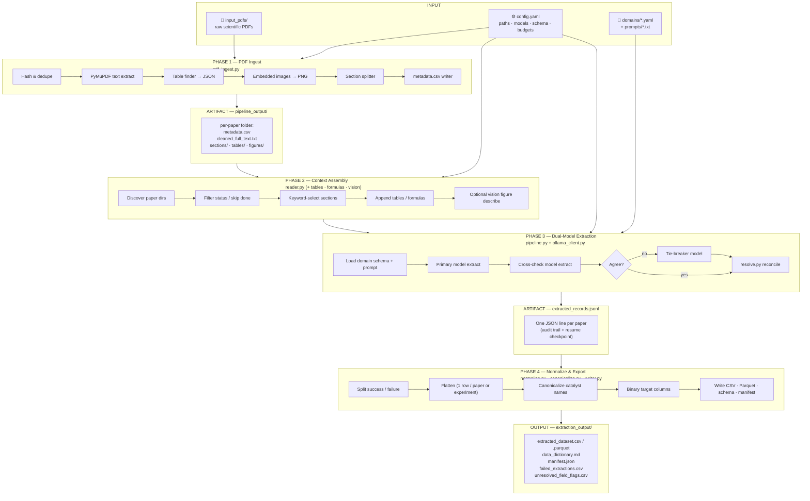
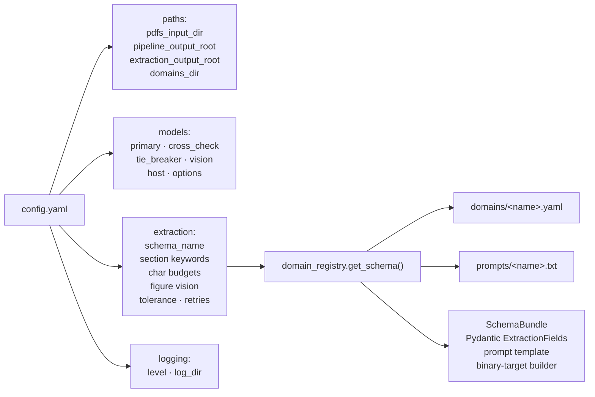
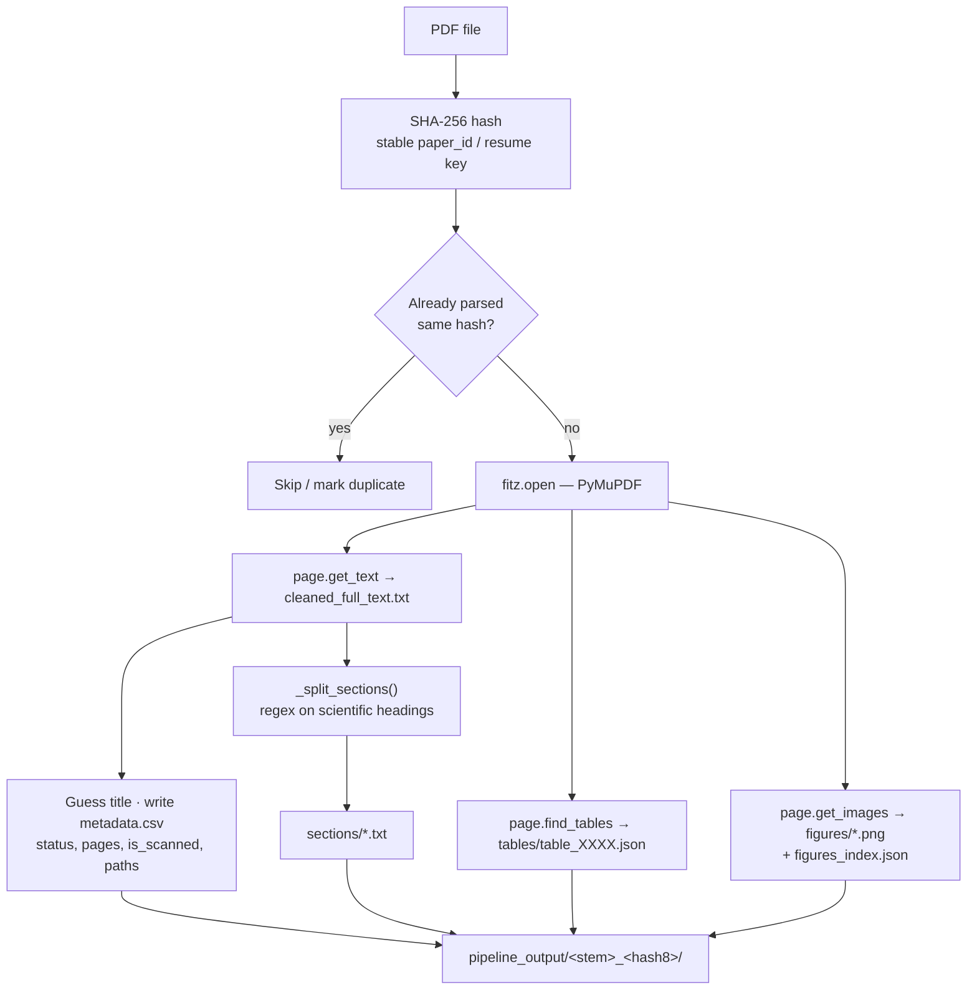
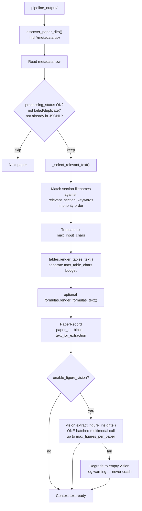
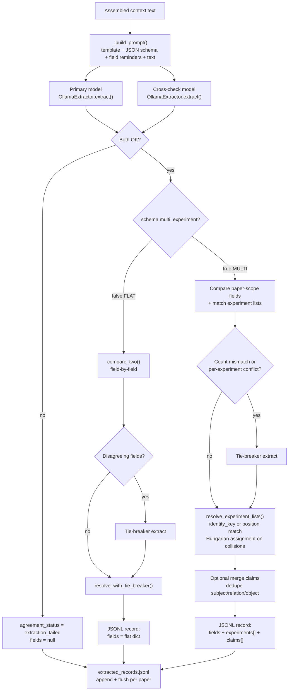
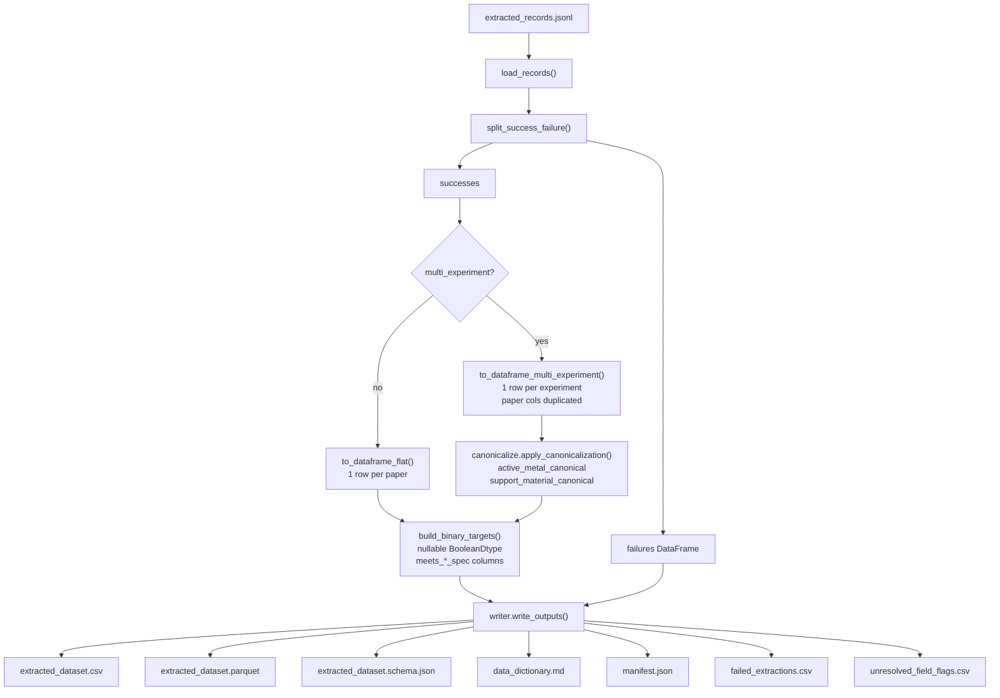
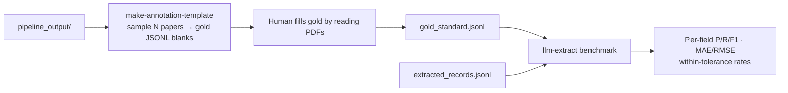
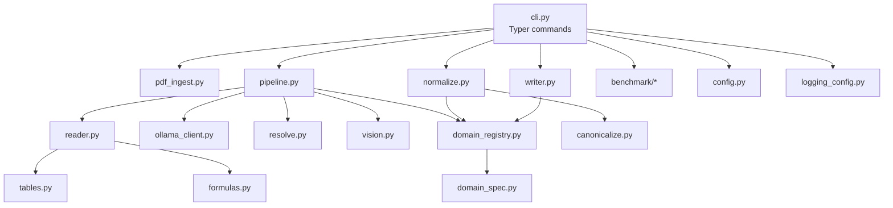

# Literature-Analysis Pipeline — Block Diagram & Component Guide

This document is the full architectural map of the `llm-extract` pipeline:
PDF literature → parsed paper folders → dual-model LLM extraction → clean ML-ready dataset.

Open this file in any Mermaid-capable viewer (GitHub, VS Code Markdown Preview, Cursor) to render the diagrams.

**Visual block diagram (HTML/SVG):** open [`pipeline_block_diagram.html`](./pipeline_block_diagram.html) in a browser for a single-page color flowchart of all four phases.

---

## 0. End-to-end overview



**One-command path:** `llm-extract from-pdfs --config config.yaml` runs Phase 1 then Phases 2–4.

**LLM-only path:** `llm-extract run --config config.yaml` skips Phase 1 (uses existing `pipeline_output/`).

**Rebuild-only path:** `llm-extract build-dataset --config config.yaml` re-runs Phase 4 only (no Ollama calls).

---

## 1. Configuration & domain layer (controls everything)



| Component | Module | Function |
|---|---|---|
| **config.yaml** | `config.py` | Single source of truth for paths, Ollama models, extraction budgets, and which domain schema to use. |
| **Domain YAML** | `domains/*.yaml` + `domain_spec.py` | Declares every extractable field (name, type, unit, enum, scope), optional `multi_experiment`, claims, and ML binary targets. No Python edit needed to add a field. |
| **Prompt template** | `prompts/*.txt` | Instruction text with `{schema}`, `{text}`, `{field_reminders}` placeholders filled at runtime. |
| **SchemaBundle** | `domain_registry.py` | Loads YAML + prompt → builds a Pydantic model used as Ollama’s JSON-schema constraint. |
| **Shipped domains** | `biodiesel`, `saf_hefa`, `methanol_synthesis`, `mof_defect_engineering` | Switch with `extraction.schema_name`. For WCO→SAF/HEFA papers use **`saf_hefa`**, not `biodiesel`. |

---

## 2. Phase 1 — PDF ingest (`pdf_ingest.py`)

**Purpose:** Turn raw PDFs into on-disk paper folders that the rest of the pipeline already understands.



### Components in this phase

| Block | What it does |
|---|---|
| **Hash & folder naming** | Content hash identifies the paper across runs; folder name = sanitized PDF stem + short hash. |
| **Text extraction** | Concatenates page text into `cleaned_full_text.txt`. If text length &lt; ~200 chars → flagged `is_scanned` (OCR-poor PDFs extract badly). |
| **Table finder** | PyMuPDF table detector; each table saved as JSON (`id`, `page`, `caption`, `data` grid). |
| **Figure extract** | Embedded images ≥ 80×80 px written as PNGs; index lists id/page/caption for the optional vision pass. |
| **Section splitter** | Regex matches common headings (Abstract, Experimental, Results, …) and writes `sections/<name>.txt`. Falls back to full text later if too few headings. |
| **metadata.csv** | Single-row catalogue: title, authors, DOI fields (when available), hash, status, paths. **Authoritative join key for discovery** — not `master_catalogue.csv`. |

### Output contract (per paper)

```
pipeline_output/<paper_folder>/
├── metadata.csv
├── cleaned_full_text.txt
├── sections/          # optional
├── tables/            # optional *.json
└── figures/           # optional figures_index.json + *.png
```

---

## 3. Phase 2 — Paper discovery & context assembly (`reader.py`, `tables.py`, `formulas.py`, `vision.py`)

**Purpose:** Build the exact text blob the LLM will see — relevant sections + tables (+ optional formulas/figures) — under char budgets from config.



### Components in this phase

| Block | Module | Function |
|---|---|---|
| **Paper discovery** | `reader.discover_paper_dirs` | Walks `pipeline_output/*/metadata.csv`. |
| **Status filter** | `reader.iter_papers` | Skips failed / pending / duplicate; skips IDs already present in `extracted_records.jsonl` (resume). |
| **Section selection** | `reader._select_relevant_text` | Substring-matches section stems to keywords (`experimental`, `catalyst`, `result`, …). Keyword order = priority. Falls back to full text if no match. |
| **Table renderer** | `tables.py` | Turns table JSON into Markdown tables; truncates at **row boundaries** (never mid-row) under `max_table_chars`. |
| **Formula renderer** | `formulas.py` | Optional; off by default. Separate char budget. |
| **Vision pass** | `vision.py` | Optional multimodal describe of figure PNGs. **Batched in one Ollama call** to avoid VRAM model-swap thrash. Graceful empty string on failure. |
| **PaperRecord** | `reader.py` | Clean dataclass handed to the extraction loop — downstream never touches file paths. |

---

## 4. Phase 3 — Dual-model structured extraction (`pipeline.py`, `ollama_client.py`, `resolve.py`)

**Purpose:** For each paper, force schema-constrained JSON extraction with two models, escalate disagreements to a third, reconcile, and append one audit line to JSONL.



### 4a. Ollama client (`ollama_client.py`)

| Responsibility | Detail |
|---|---|
| **Preflight** | `check_ollama_ready()` — server reachable + all configured models pulled, before any paper runs. |
| **Structured decode** | Passes Pydantic JSON schema as Ollama `format` (grammar-constrained). Falls back to `format="json"` on older servers. |
| **Cleaning** | Strips ```json fences some models still emit. |
| **Retries** | Transport / parse / validation failures retry with backoff (`max_retries`, `retry_wait_seconds`). |
| **Contract** | Returns `CallResult`: either a **valid** Pydantic instance or an explicit failure — never a silent partial object. |

### 4b. Flat vs multi-experiment paths

| Mode | When | Unit of analysis | Resolve behavior |
|---|---|---|---|
| **Flat** | e.g. `biodiesel` | One record per paper | Field-by-field compare; numeric tolerance; majority / median with tie-breaker. |
| **Multi-experiment** | e.g. `saf_hefa` | One record per catalyst/condition row | Match experiments across models by catalyst identity key; disambiguate duplicate names with numeric similarity (Hungarian algorithm); flag `single_model_only` extras. |

**Why multi-experiment matters:** If two models each pick a *different* table row from the same paper, every field “disagrees.” That is experiment **misalignment**, not noisy OCR. `diagnose_disagreement_pattern()` logs this diagnosis when most fields disagree at once.

### 4c. Resolve rules (`resolve.py`) — summary

| Situation | Action |
|---|---|
| Numeric within relative tolerance (+ tiny absolute floor) | Agree |
| Categorical exact match (case-insensitive) | Agree |
| Two of three models agree after tie-breaker | Take majority |
| Numeric three-way split | Median |
| No majority | Field → `null`, listed in `unresolved_fields` |
| Experiment identity match fails | Fall back to position match; log warning (`match_method=position`) |
| Hit exact `max_experiments` | Warning: possible silent truncation by schema `maxItems` |

### 4d. Resume / audit artifact

`extraction_output/extracted_records.jsonl` is both:

1. **Audit trail** — provenance, models used, agreement status, raw resolved fields  
2. **Checkpoint** — paper_ids already present are skipped on the next `run`

---

## 5. Phase 4 — Normalize, canonicalize, write (`normalize.py`, `canonicalize.py`, `writer.py`)

**Purpose:** Turn JSONL into a typed, documented dataset package for inspection and ML.



### Components in this phase

| Block | Function |
|---|---|
| **Success / failure split** | Failures never silently disappear — they land in `failed_extractions.csv`. |
| **Flattening** | Flat domains → 1 row/paper. Multi-experiment → 1 row/experiment with `experiment_id`, match status, evidence spans. |
| **Canonicalization** | Normalizes catalyst/support spelling variants for ML join keys without erasing the LLM’s original string. |
| **Binary targets** | Domain YAML thresholds → `meets_*` columns. Uses **nullable booleans** so “not reported” ≠ “fails spec”. |
| **ML readiness flag** | If `ml_core_fields` listed in domain YAML → `ml_core_features_complete` column. |
| **Writer package** | One directory is the full consumer contract: data + schema + dictionary + manifest + failure flags. |

---

## 6. Optional validation loop (benchmark)



Use this before claiming extraction accuracy for downstream ML papers.

---

## 7. Module map (code ↔ responsibility)



| Module | Phase | Role |
|---|---|---|
| `cli.py` | — | Entry: `from-pdfs`, `run`, `build-dataset`, `make-annotation-template`, `benchmark` |
| `config.py` | 0 | Load / validate `config.yaml` |
| `pdf_ingest.py` | 1 | PDF → paper folders |
| `reader.py` | 2 | Discovery + context text |
| `tables.py` / `formulas.py` | 2 | Structured supplements to prose |
| `vision.py` | 2 | Optional figure descriptions |
| `domain_spec.py` / `domain_registry.py` | 0/3 | YAML → Pydantic + prompt |
| `ollama_client.py` | 3 | All Ollama I/O |
| `pipeline.py` | 3 | Orchestrate extract / escalate / write JSONL |
| `resolve.py` | 3 | Cross-model field & experiment reconciliation |
| `normalize.py` | 4 | JSONL → clean DataFrame |
| `canonicalize.py` | 4 | Catalyst/support name normalization |
| `writer.py` | 4 | Dataset package on disk |
| `benchmark/*` | optional | Gold-standard scoring |

---

## 8. Data flow by artifact

| Stage | Artifact | Produced by | Consumed by |
|---|---|---|---|
| Input | `input_pdfs/*.pdf` | User | `pdf_ingest` |
| Parsed | `pipeline_output/<paper>/…` | `pdf_ingest` | `reader`, vision, annotation template |
| Control | `config.yaml` + `domains/` + `prompts/` | User / repo | All phases |
| Raw extract | `extraction_output/extracted_records.jsonl` | `pipeline` | `normalize`, `benchmark`, resume |
| Clean ML set | `extracted_dataset.csv` / `.parquet` | `writer` | You / downstream ML |
| Docs | `data_dictionary.md`, `schema.json`, `manifest.json` | `writer` | Humans / reproducibility |
| QA | `failed_extractions.csv`, `unresolved_field_flags.csv` | `writer` | Debugging extraction quality |

---

## 9. Agreement status meanings

| Status | Meaning |
|---|---|
| `full_agreement` | Primary and cross-check matched (within tolerance); no tie-breaker needed. |
| `resolved_after_escalation` | Disagreement fixed by tie-breaker majority/median. |
| `unresolved_conflict` | At least one field/experiment still conflicted after three models. |
| `extraction_failed` | One or both bulk models failed validation/transport; `fields=null`. |
| `single_model_only` *(experiment)* | Only one model reported that catalyst/condition row. |

---

## 10. Practical run checklist

1. Put PDFs in `input_pdfs/`.
2. Set `extraction.schema_name` to the topic that matches the papers (e.g. `saf_hefa` for WCO→jet fuel).
3. Ensure `ollama serve` is up and models in `config.yaml` are pulled.
4. Run: `llm-extract from-pdfs --config config.yaml`
5. Inspect: `extraction_output/extracted_dataset.csv`
6. After threshold-only YAML edits: `llm-extract build-dataset --config config.yaml` (no re-LLM).
7. For accuracy claims: annotation template → human gold → `llm-extract benchmark`.

---

*Generated from the `llm_extract` package layout (`cli`, `pdf_ingest`, `reader`, `pipeline`, `resolve`, `normalize`, `writer`, `domain_*`, `vision`, `ollama_client`). Update this file if those contracts change.*
